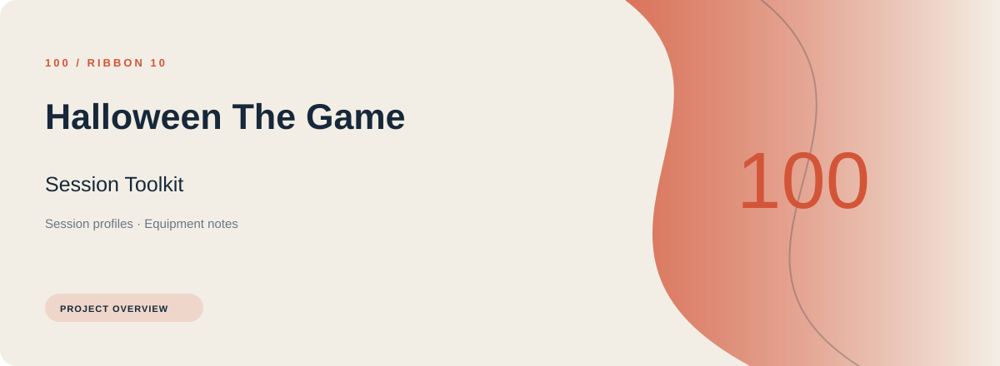
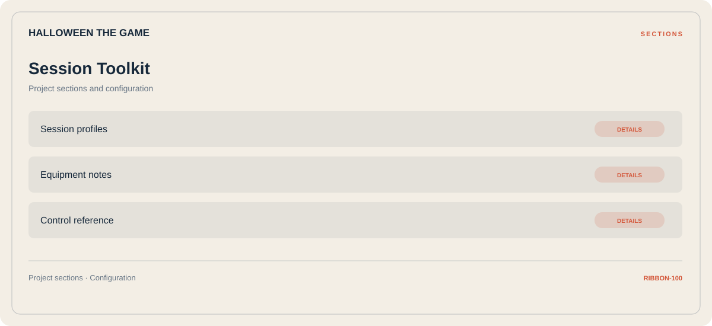

# 🛠️ Halloween The Game Session Toolkit

**Session profiles · Equipment notes · Control reference**

## ⚡ Features

A task-oriented Halloween The Game session toolkit workspace: session profiles first, equipment notes next, and control reference as the final reference area.

### ⚙️ Session profiles

Related settings collected into named groups for a clearer configuration workflow.

### 🧩 Equipment notes

Equipment categories and the associated selection or configuration options.

### ⌨️ Control reference

A dedicated section for control reference and the configuration details associated with that area.

## 🖥️ Project navigation

## 📥 Download

The button and cover open the project's download page. Use the information supplied with the downloaded package for installation and release-specific requirements.

## 📚 Project documentation

- [Feature reference](docs/FEATURES.md)
- [Download information](docs/DOWNLOAD.md)
- [Project page](index.html)

---

Halloween The Game Session Toolkit · Program documentation and download information.
